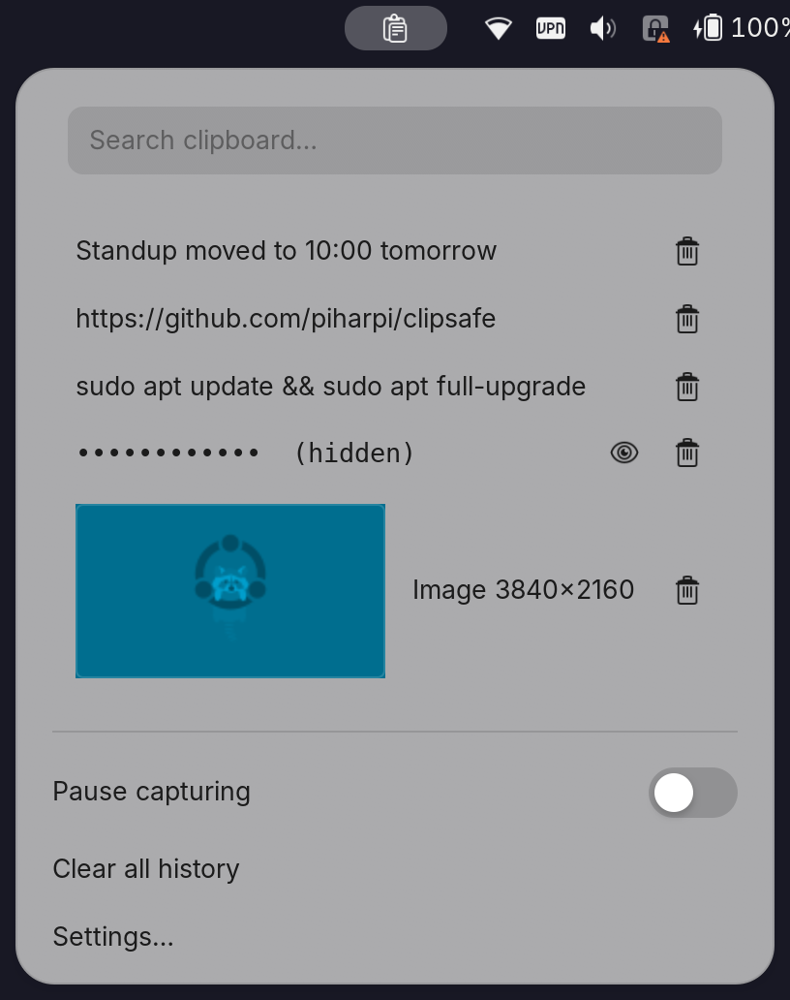
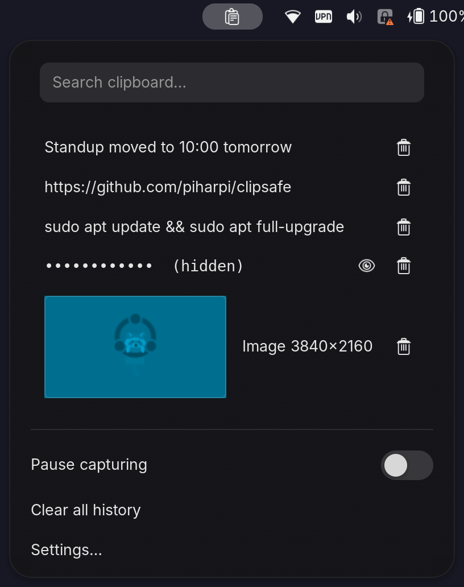

# ClipSafe

Security-first clipboard history for GNOME Shell. Popular clipboard managers keep your history as plain files on disk, including every password and token you ever copied. ClipSafe keeps text in memory only and refuses to store secrets in the first place.

| Light | Dark |
| --- | --- |
|  |  |

## Security model

- **Text never touches disk.** Text history lives only in GNOME Shell's memory and is gone on logout.
- **Password-manager secrets are never captured.** Copies flagged with the `x-kde-passwordManagerHint` MIME type (Bitwarden, KeePassXC, 1Password, …) are skipped before their content is read.
- **Secrets are masked.** Entries that look like a private key, JWT, API token (`sk-`, `ghp_`, `xox*`, `AKIA…`, `AIza…`) or a long high-entropy string are stored masked (`••••••  (hidden)`). An eye button reveals one entry on demand.
- **Your own rules.** Regex patterns and an app blocklist (by WM_CLASS) keep chosen content out entirely.
- **Auto-expire.** Optionally remove masked entries after *N* seconds, wipe everything after *N* minutes idle, or wipe on screen lock.
- **Images** are kept in a session-only cache, `~/.cache/clipsafe/`, written with `0600` permissions. Only a small thumbnail stays in memory. The cache is wiped when the extension starts and when it stops, so it never outlives a session.
- **Lock screen.** The indicator is hidden and nothing is captured while the screen is locked. ClipSafe runs in `unlock-dialog` mode only so your history survives a lock (unless *Clear history on screen lock* is on).

## Features

- History of text and images in the top bar; click an entry to copy it again, trash icon to delete it.
- **Super+V** opens the menu (rebindable in Settings).
- Search box, focused as soon as the menu opens.
- Pause capturing, Clear all history.
- Settings: history size, maximum text length, image capture on/off and maximum image size.

GNOME Shell 50.

## Install

```bash
git clone https://github.com/piharpi/clipsafe ~/.local/share/gnome-shell/extensions/clipsafe@harpi
glib-compile-schemas ~/.local/share/gnome-shell/extensions/clipsafe@harpi/schemas
# log out and back in (Wayland), then:
gnome-extensions enable clipsafe@harpi
```

## Tested on

| | |
| --- | --- |
| Device | Lenovo ThinkPad E14 Gen 7 (21SX) |
| CPU | Intel Core Ultra 7 255H (16 threads) |
| GPU | Intel Graphics (Arrow Lake-P, integrated) |
| RAM | 29.8 GiB usable |
| OS | Ubuntu 26.04.1 LTS, kernel 7.0.0-42-generic |
| Desktop | GNOME Shell 50.1, Wayland session |
| Clipboard | Text and PNG images, Wayland session |

## License

GPL-2.0-or-later
